<div align="center">

<p align="center">
  
</p>

**Enterprise Natural Language → SQL Data Intelligence Platform**


</div>

Ask your databases questions in plain English — AskDB translates them into safe, read-only SQL, executes them against your **PostgreSQL / MySQL** databases, and returns the query, the results, and a plain-language business insight with actionable recommendations.

## Table of Contents

- [Description](#description)
- [Features](#features)
- [Tech Stack](#tech-stack)
- [Architecture](#architecture)
- [Screenshots](#screenshots)
- [Installation](#installation)
- [Environment Variables](#environment-variables)
- [Running the Project](#running-the-project)
- [Usage](#-usage)
- [API Documentation](#-api-documentation)
- [Safety & Security Model](#safety--security-model)
- [Token Efficiency](#token-efficiency)
- [Folder Structure](#folder-structure)
- [Author](#-author--contact)
- [Acknowledgements](#-acknowledgements)

---

## Description

**AskDB** is a full-stack, multi-agent platform that lets business users interrogate their
databases conversationally. Instead of learning SQL or waiting for a data analyst, users type a
question such as _"Which product category generated the most revenue last quarter?"_ — and
AskDB:

1. **Understands** the question in the context of the database's live schema.
2. **Generates** a single, safe, read-only SQL statement.
3. **Executes** it against the connected PostgreSQL or MySQL database under strict safety guards.
4. **Explains** the result with a table and a synthesized business insight + recommendations.

The platform is built as a three-tier monorepo:

| Tier           | Directory  | Role                                                                                                                                |
| -------------- | ---------- | ----------------------------------------------------------------------------------------------------------------------------------- |
| 🚪 API Gateway | `server/`  | Express.js (Node ≥ 18) — the **only internet-facing service**. Owns JWT authentication, MongoDB-backed rate limiting, and proxying. |
| 🧠 Core Engine | `backend/` | FastAPI + LangGraph (Python 3.11) — internal-only. Runs the NL → SQL agent pipeline and talks to customer databases.                |
| 🎨 Frontend    | `client/`  | React 18 + Vite 5 + Tailwind CSS 3.4 — Material 3 dark-mode web app.                                                                |

---

## Features

- **🗣️ Natural Language → SQL** — LangGraph multi-agent pipeline converts questions into SQL.
- **🎙️ Voice input in chat** — Chrome/Edge users can dictate questions directly in the chat composer using the Web Speech API; transcripts appear in the input box for quick review before sending.
- **🤖 Two specialized agents** — a **Main Analyst** (Groq · Llama-3.3-70B) plans and revises
  queries, and an **Insight Synthesizer** (Google Gemini 2.5 Flash) turns tabular results into
  plain-language business insights.
- **📦 Three-part chat response** — each turn returns up to three assistant messages:
  `sql` (the generated query), `table` (the results), and `insight` (analysis + recommendations).
- **🛡️ Defense-in-depth read-only enforcement** — static SQL validation, automatic `LIMIT`,
  read-only sessions, statement timeouts, and a write-probe that refuses writable credentials.
- **🗃️ Automatic schema awareness** — introspects your database and caches a compact schema in
  MongoDB (6-hour TTL) so agents never re-query `information_schema` per turn.
- **⚡ Token-efficient context** — condensed 6-turn chat history, a compact
  `table(col:type[PK][FK->ref])` schema format, and insight synthesis only on non-empty results
  with a capped 25-row sample.
- **🔐 Enterprise authentication** — JWT access tokens + rotating refresh tokens, bcrypt
  password hashing, and `express-validator` input validation.
- **✉️ Email OTP password reset** — 4-step self-service flow (email → 6-digit OTP verification →
  new password → success) with auto-focus/paste OTP boxes, a 60-second resend timer, and a
  branded HTML email delivered via Gmail SMTP (nodemailer).
- **🚦 Distributed rate limiting** — `rate-limit-mongo` store enforces limits consistently across
  gateway instances; stricter limits on chat and auth endpoints.
- **🔒 Credentials encrypted at rest** — customer database passwords are stored in MongoDB
  encrypted with Fernet (`cryptography`), never in plaintext.
- **🎨 Material 3 dark UI** — indigo primary (`#c3c0ff`), cyan tertiary (`#4cd7f6`), on a deep
  background (`#131318`), with `framer-motion` animations.
- **🐳 Docker & local dev** — deploy with Docker Compose or run each service locally.

---

## Tech Stack

| Layer                  | Technology                                                            | Version       |
| ---------------------- | --------------------------------------------------------------------- | ------------- |
| API Gateway            | Express.js (Node.js ≥ 18)                                             | 4.19          |
| Gateway middleware     | helmet · cors · morgan · cookie-parser · winston                      | —             |
| Auth & validation      | jsonwebtoken · bcryptjs · express-validator                           | 9 / 2.4 / 7.1 |
| Email delivery         | nodemailer (Gmail SMTP)                                              | 6.9           |
| Rate limiting          | express-rate-limit + rate-limit-mongo                                 | 7.3 / 2.3     |
| Core service           | FastAPI (Python 3.11) + uvicorn                                       | 0.111 / 0.30  |
| Agent orchestration    | LangGraph                                                             | 0.1.16        |
| Analyst LLM            | Groq · Qwen 3.6-27B (via `langchain-groq`)                            | 0.1.9         |
| Insight LLM            | Google Gemini 2.5 Flash (via `langchain-google-genai`)                | 1.0.8         |
| Application DB / cache | MongoDB (Mongoose 8 — gateway · Motor 3.5 / PyMongo 4.8 — core)       | —             |
| Customer databases     | PostgreSQL (`psycopg2-binary`) · MySQL (`pymysql`) via SQLAlchemy     | 2.0.31        |
| Encryption at rest     | Fernet (`cryptography`)                                               | 42.0.8        |
| Frontend               | React 18 · React Router 6 · Vite 5 · Tailwind CSS 3.4 · framer-motion | —             |
| Runtime / DevOps       | Docker · Docker Compose · nodemon · `uv`                              | —             |

---

## Architecture

```
┌──────────────┐        ┌──────────────────┐        ┌─────────────────────┐
│   Browser    │  HTTP  │   Express Gateway│  HTTP  │   FastAPI Core      │
│  React 18 +  │ ─────► │   (server/ :8080)│ ─────► │   (backend/ :8000)  │
│  Vite :5173  │  JWT   │  auth + ratelimit│secret  │  LangGraph agents   │
└──────────────┘        └────────┬─────────┘        └─────────┬───────────┘
                                 │                            │
                                 ▼                            ▼
                        ┌─────────────────┐          ┌─────────────────────┐
                        │  MongoDB Atlas  │          │  Customer DB        │
                        │ users · limits  │          │  PostgreSQL / MySQL │
                        │ sessions ·      │          │  (read-only, safe)  │
                        │ schemas (cache) │          └─────────────────────┘
                        └─────────────────┘
```

**Request flow:**

1. The browser talks **only** to the gateway (`:8080`) — auth endpoints and `/api/*` routes.
2. The gateway verifies the JWT, applies per-user / per-IP rate limits (MongoDB-backed), then
   **proxies** `/api/chat`, `/api/connection`, and `/api/sessions` to the FastAPI core.
3. On each proxied request the gateway injects `x-gateway-secret` plus the authenticated
   identity headers (`x-user-id`, `x-user-email`, `x-user-role`).
4. The core service rejects any request that does **not** carry the matching
   `x-gateway-secret` — it trusts only the gateway and is never published to the host in Docker.
5. The LangGraph pipeline (Main Analyst → Insight Synthesizer) generates, validates, and
   executes read-only SQL against the customer database, then returns `sql` + `table` +
   `insight` messages.

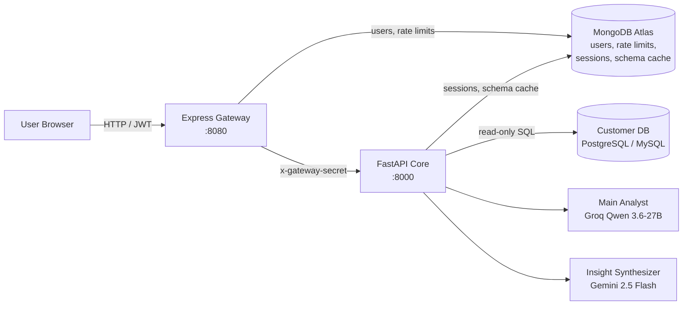

## Screenshots

### Home Page

#### Landing View

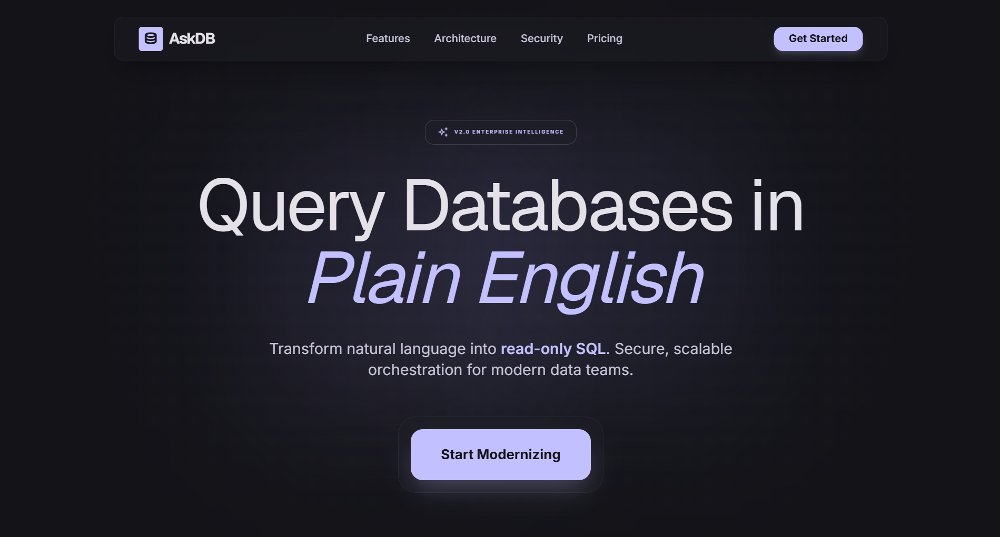

#### Features & Overview

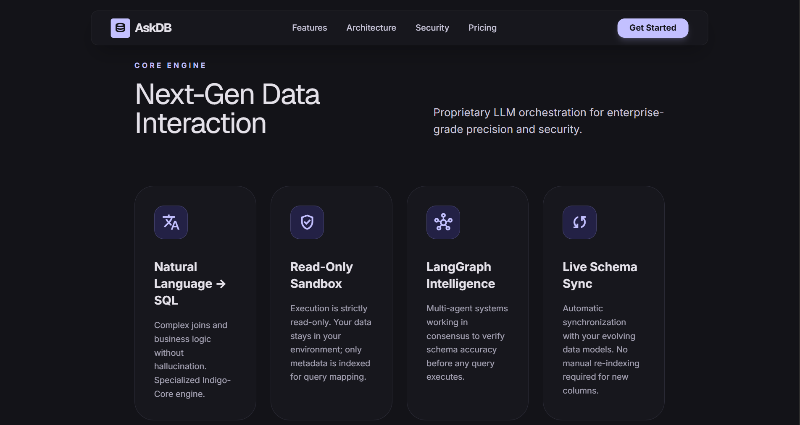
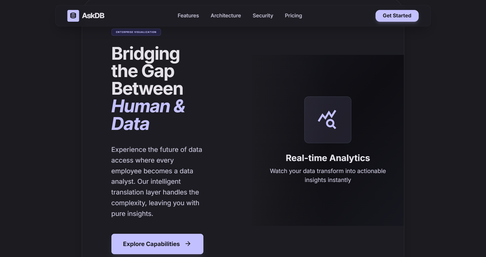
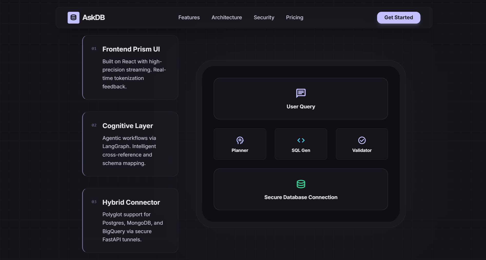
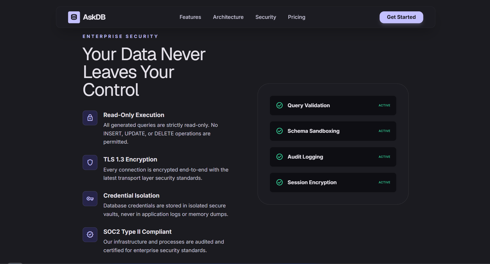

---

### Chat Interface

#### Chat Interface

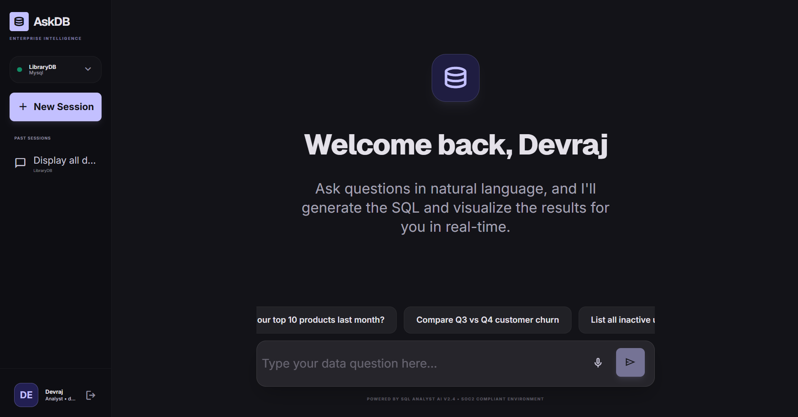

#### Data Results Table

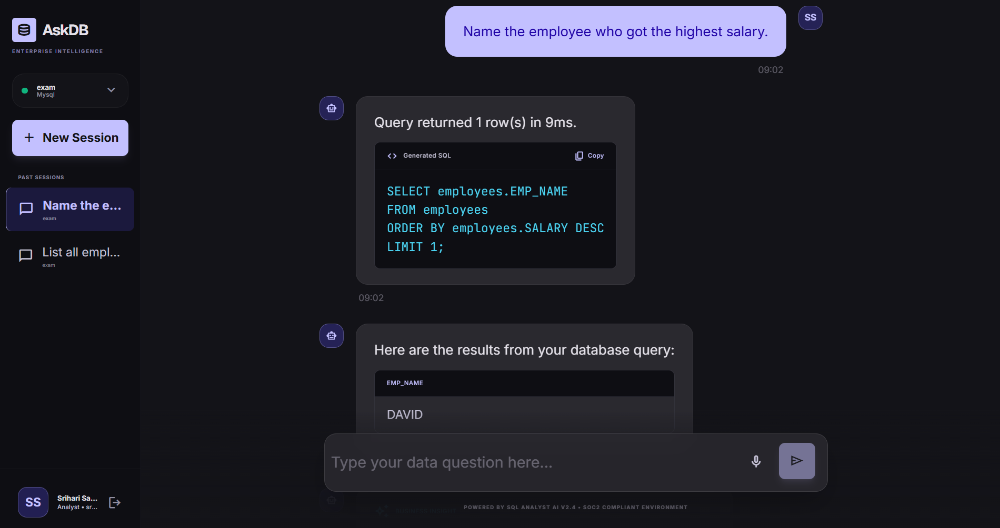

#### AI Insights & Analysis

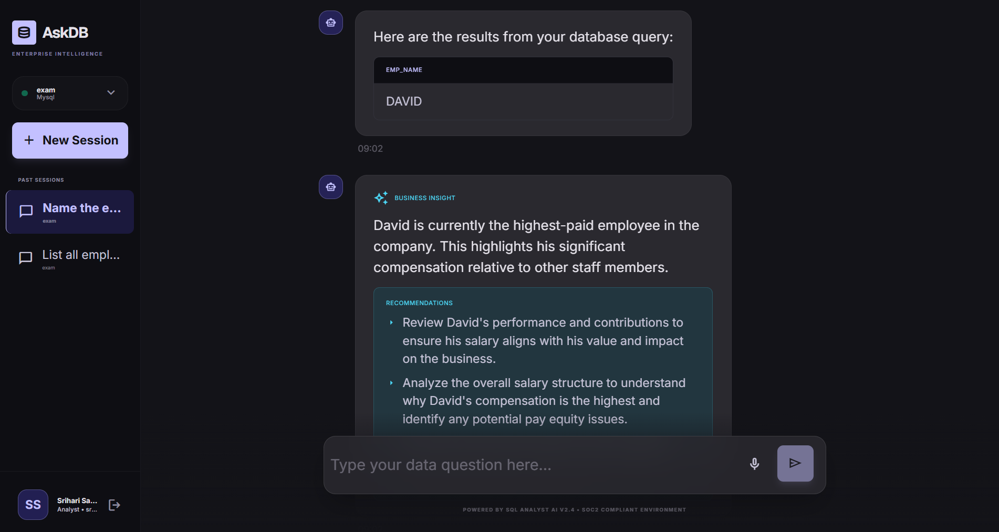

---

### Connect Database

#### Connection Database

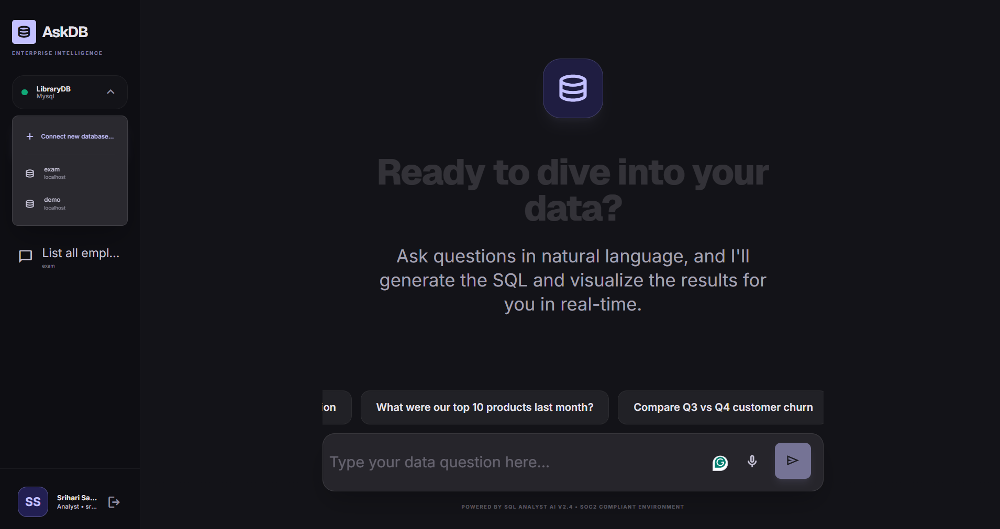

#### Connection Form

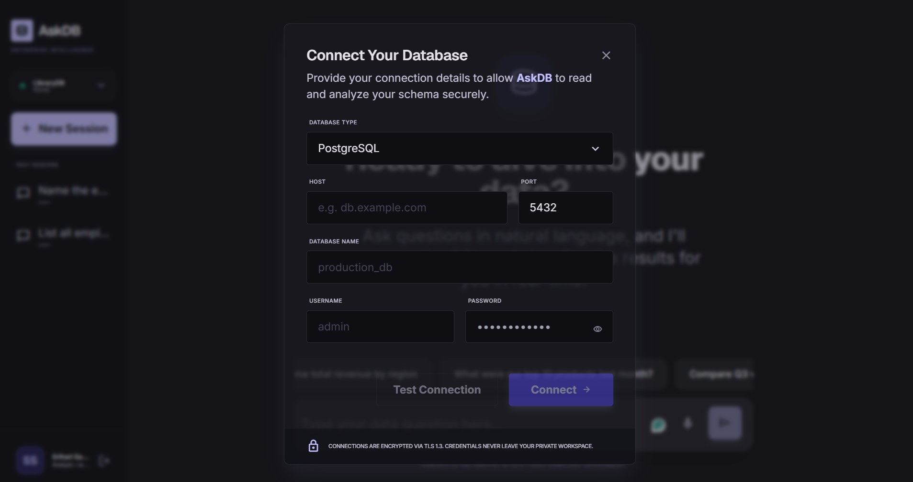

---

### Authentication

#### Login Page

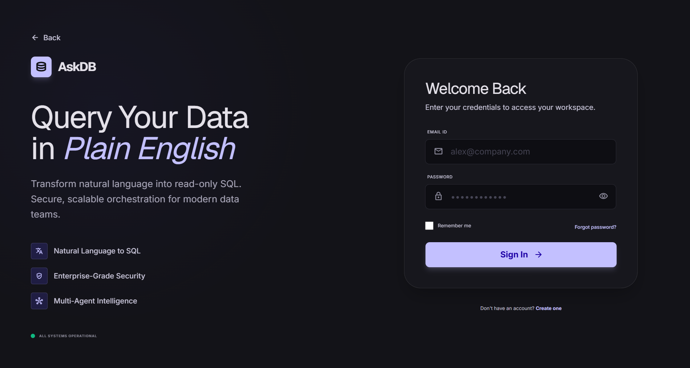

#### Sign Up Page

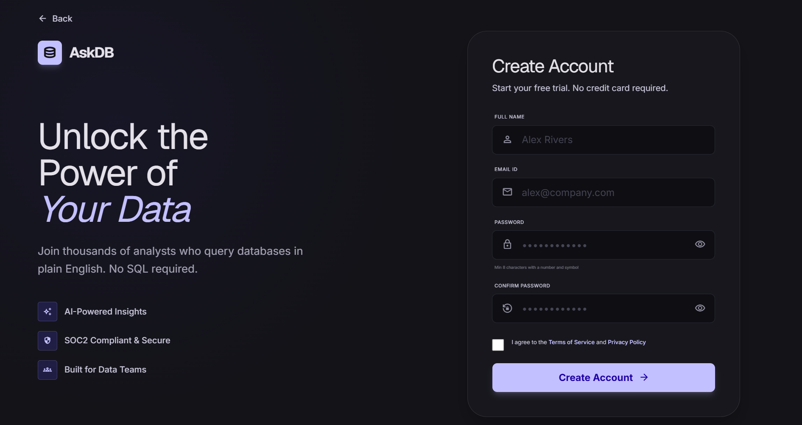

## Installation

### Prerequisites

| Requirement         | Version                                                                                                |
| ------------------- | ------------------------------------------------------------------------------------------------------ |
| Node.js             | ≥ 18 (gateway uses 20-slim in Docker)                                                                  |
| Python              | 3.11                                                                                                   |
| Package managers    | npm · `uv` (recommended) or pip                                                                        |
| MongoDB             | MongoDB Atlas URI (shared by gateway + core)                                                           |
| LLM API keys        | [Groq](https://console.groq.com) (analyst) · [Google AI Studio](https://aistudio.google.com) (insight) |
| Databases (targets) | A PostgreSQL or MySQL instance with **read-only credentials**                                          |

### Clone

```bash
git clone https://github.com/harysri/AskDB.git
cd AskDB
```

---

## Environment Variables

The project is configured via `.env` files in `server/` and `backend/`.

### `server/.env` — API Gateway

| Variable                        | Required | Default                 | Description                                                                               |
| ------------------------------- | -------- | ----------------------- | ----------------------------------------------------------------------------------------- |
| `PORT`                          | No       | `8080`                  | Gateway listen port.                                                                      |
| `NODE_ENV`                      | No       | `development`           | Runtime environment.                                                                      |
| `FASTAPI_TARGET_URL`            | No       | `http://localhost:8000` | Internal URL of the FastAPI core.                                                         |
| `TRUSTED_GATEWAY_HEADER_SECRET` | **Yes**  | —                       | Shared secret injected as `x-gateway-secret`. **Must match the backend value.**           |
| `MONGODB_URI`                   | **Yes**  | —                       | MongoDB Atlas connection string (users + rate-limit store).                               |
| `JWT_SECRET`                    | **Yes**  | —                       | Signing secret for access tokens.                                                         |
| `JWT_EXPIRES_IN`                | No       | `15m`                   | Access-token lifetime.                                                                    |
| `JWT_REFRESH_SECRET`            | **Yes**  | —                       | Signing secret for refresh tokens.                                                        |
| `JWT_REFRESH_EXPIRES_IN`        | No       | `7d`                    | Refresh-token lifetime.                                                                   |
| `RATE_LIMIT_WINDOW_MS`          | No       | `60000`                 | Rate-limit window (ms).                                                                   |
| `RATE_LIMIT_MAX_REQUESTS`       | No       | `60`                    | General API limit per window.                                                             |
| `RATE_LIMIT_CHAT_MAX_REQUESTS`  | No       | `15`                    | Chat endpoint limit per window.                                                           |
| `ALLOWED_ORIGINS`               | No       | `http://localhost:3000` | Comma-separated CORS origins. **Set to `http://localhost:5173` for the Vite dev server.** |
| `SMTP_HOST`                     | No       | `smtp.gmail.com`        | SMTP server host for OTP emails.                                                          |
| `SMTP_PORT`                     | No       | `465`                   | SMTP port (465 = implicit TLS).                                                            |
| `SMTP_SECURE`                   | No       | `true`                  | Use TLS (`false` for port 587 with STARTTLS).                                             |
| `SMTP_USER`                     | No\*     | —                       | Gmail address used to send OTP emails.                                                    |
| `SMTP_PASS`                     | No\*     | —                       | Gmail **app password** (16 chars, no spaces). Required for OTP email delivery.            |
| `SMTP_FROM`                     | No       | `SMTP_USER`             | From header, e.g. `"AskDB <you@gmail.com>"`.                                              |
| `OTP_TTL_MINUTES`               | No       | `10`                    | OTP expiry window in minutes.                                                             |
| `OTP_MAX_ATTEMPTS`              | No       | `5`                     | Wrong guesses before an OTP is invalidated.                                               |
| `OTP_MAX_SENDS`                 | No       | `3`                     | Max OTP requests per email within the TTL window.                                         |

\* If `SMTP_USER`/`SMTP_PASS` are empty, OTP emails are skipped (dev log only) — the reset flow
still works end-to-end for testing without a mail server.

### `backend/.env` — Core Service

| Variable                                                                                                                  | Required | Default            | Description                                                               |
| ------------------------------------------------------------------------------------------------------------------------- | -------- | ------------------ | ------------------------------------------------------------------------- |
| `APP_ENV`                                                                                                                 | No       | `development`      | Environment label.                                                        |
| `APP_HOST` / `APP_PORT`                                                                                                   | No       | `0.0.0.0` / `8000` | Core bind address.                                                        |
| `LOG_LEVEL`                                                                                                               | No       | `INFO`             | Logging verbosity.                                                        |
| `TRUSTED_GATEWAY_HEADER_SECRET`                                                                                           | **Yes**  | —                  | **Must match the gateway value.**                                         |
| `MONGODB_URI`                                                                                                             | **Yes**  | —                  | MongoDB Atlas connection string (sessions, schema cache).                 |
| `MONGODB_DB_NAME`                                                                                                         | No       | `cluster0`         | MongoDB database name.                                                    |
| `GROQ_API_KEY`                                                                                                            | **Yes**  | —                  | Groq API key for the Main Analyst.                                        |
| `GROQ_MODEL`                                                                                                              | No       | `qwen/qwen3.6-27b` | Groq analyst model.                                                       |
| `GOOGLE_API_KEY`                                                                                                          | **Yes**  | —                  | Google AI key for the Insight Synthesizer.                                |
| `GEMINI_MODEL`                                                                                                            | No       | `gemini-2.5-flash` | Insight model.                                                            |
| `MAX_AGENT_ITERATIONS`                                                                                                    | No       | `6`                | Max query revision attempts.                                              |
| `MAX_ROWS_RETURNED`                                                                                                       | No       | `200`              | Automatic `LIMIT` for every query.                                        |
| `SQL_QUERY_TIMEOUT_SECONDS`                                                                                               | No       | `15`               | Session-level statement timeout.                                          |
| `TOKEN_BUDGET_PER_TURN`                                                                                                   | No       | `6000`             | Token budget for a chat turn.                                             |
| `DEFAULT_DB_TYPE` / `DEFAULT_DB_HOST` / `DEFAULT_DB_PORT` / `DEFAULT_DB_NAME` / `DEFAULT_DB_USER` / `DEFAULT_DB_PASSWORD` | No       | —                  | Fallback target database (overridden per-session via `/api/connection`).  |
| `CREDENTIALS_ENCRYPTION_KEY`                                                                                              | **Yes**  | —                  | Fernet key (32 URL-safe base64 bytes) for encrypting stored DB passwords. |

### `client/`

The frontend requires **no environment variables** — Vite's dev proxy (`vite.config.js`)
forwards `/auth` and `/api` to `http://localhost:8080`, so the browser calls the same origin.

---

## Running the Project

### Local development (three terminals)

**1. Core service** (`backend/`):

```bash
cd backend
uv venv --python 3.11 --seed .venv          # or: python3.11 -m venv .venv
source .venv/bin/activate                    # Windows: .venv\Scripts\activate
uv pip install -r requirements.txt           # or: pip install -r requirements.txt
uvicorn app.main:app --reload --port 8000
```

**2. API Gateway** (`server/`):

```bash
cd server
npm install
npm run dev
```

**3. Frontend** (`client/`):

```bash
cd client
npm install
npm run dev
```

Open `http://localhost:5173` — Vite proxies API calls to the gateway on `:8080`.

---

## 💬 Usage

1. **Register / sign in** at the home page (JWT access + refresh tokens are issued).
   Forgot your password? Use **Forgot password?** on the login page for the 4-step email OTP
   reset flow (email → 6-digit code → new password → success).
2. **Connect a database** using the _Connect Database_ modal — provide PostgreSQL/MySQL
   credentials. AskDB will:
   - verify connectivity,
   - run the read-only write-probe,
   - **reject the connection if the credentials can write**,
   - encrypt and store the credentials (Fernet) for later reuse.
3. **Start a chat session** and ask a business question in plain English.
4. Review the response — up to three assistant messages in order:
   - 💾 **SQL** — the generated read-only query (with a short narration),
   - 📊 **Table** — the query results,
   - 💡 **Insight** — a plain-language summary plus 2–4 actionable recommendations
     (only when rows are returned).
5. Manage sessions (rename, archive, delete) and switch connected databases from the sidebar.

---

## 📡 API Documentation

All routes below are exposed through the gateway at `http://localhost:8080`. Chat/connection/
sessions routes require `Authorization: Bearer <accessToken>`.

### Authentication (public)

| Method | Endpoint             | Description                                                                                       |
| ------ | -------------------- | ------------------------------------------------------------------------------------------------- |
| `POST` | `/auth/register`     | Create an account (email, password ≥ 8 chars, optional name).                                     |
| `POST` | `/auth/login`        | Sign in → returns `{ user, accessToken, refreshToken }`.                                          |
| `POST` | `/auth/refresh`      | Rotate refresh token → new access + refresh tokens.                                               |
| `POST` | `/auth/logout`       | Revoke the refresh token (`204`).                                                                 |
| `POST` | `/auth/send-otp`     | Email a 6-digit password-reset OTP (expires in 10 min, max 3 sends per window).                   |
| `POST` | `/auth/verify-otp`   | Verify the OTP → `{ message: "OTP verified", valid: true }` (5 wrong attempts invalidate it).     |
| `POST` | `/auth/reset-password` | Set a new password using a verified OTP; consumes the OTP and revokes all sessions.             |

### Password reset flow

1. **`/auth/send-otp`** — body `{ email }`. Generates a random 6-digit OTP, stores only its
   SHA-256 hash (with pepper) in `password_reset_otps` with a 10-minute TTL, and emails it via
   Gmail SMTP. Returns a generic success message even for unknown emails (anti-enumeration).
2. **`/auth/verify-otp`** — body `{ email, otp }`. Checks match + expiry + attempt limit,
   then marks the OTP as verified for the final step.
3. **`/auth/reset-password`** — body `{ email, otp, newPassword }`. Re-verifies the OTP,
   bcrypt-hashes the new password, invalidates the OTP (single-use), and clears the stored
   refresh token so all existing sessions must re-login.

### Database connections

| Method   | Endpoint               | Description                                                                   |
| -------- | ---------------------- | ----------------------------------------------------------------------------- |
| `POST`   | `/api/connection/test` | Test connectivity + read-only enforcement **without persisting** credentials. |
| `GET`    | `/api/connection`      | List saved connections (most recently used first).                            |
| `POST`   | `/api/connection`      | Connect and persist a connection (read-only verified, `422` if not).          |
| `DELETE` | `/api/connection/:id`  | Delete a connection (`204`).                                                  |

### Chat

| Method | Endpoint    | Description                                                                                                                                                                              |
| ------ | ----------- | ---------------------------------------------------------------------------------------------------------------------------------------------------------------------------------------- |
| `POST` | `/api/chat` | Send a message. Body: `{ "message": "...", "session_id?": "...", "connection_id?" : "..." }`. Returns up to three assistant messages: `sql`, `table`, `insight` (or `error` on failure). |

### Health

| Method | Endpoint  | Description                       |
| ------ | --------- | --------------------------------- |
| `GET`  | `/health` | Gateway health (unauthenticated). |
| `GET`  | `/health` | Core health (internal — `:8000`). |

---

## Safety & Security Model

AskDB treats "the agent must never modify your data" as a hard invariant, enforced with
**defense in depth**:

1. **Static SQL validation** (`backend/app/tools/sql_tool.py`)
   - Only a single `SELECT` / `WITH` (CTE) statement is accepted.
   - A blocklist of DML/DDL keywords (`INSERT`, `UPDATE`, `DELETE`, `DROP`, `TRUNCATE`, …)
     rejects a statement even if the keyword is hidden in a comment or string literal
     (fail-closed).
   - Stacked / multi-statement queries are rejected.

2. **Automatic row limiting**
   - A `LIMIT` (default **200 rows**) is appended to every query that doesn't already define
     one, so a single query can never return an unbounded result set.

3. **Read-only sessions + timeouts** (`backend/app/database/sql_connector.py`)
   - PostgreSQL: `SET SESSION CHARACTERISTICS AS TRANSACTION READ ONLY` +
     `SET statement_timeout` on every connection.
   - MySQL: `SET SESSION TRANSACTION READ ONLY` + `SET SESSION MAX_EXECUTION_TIME`.
   - Statement timeout default: **15 seconds**.

4. **Write-probe verification** (`verify_read_only()`)
   - On connect, AskDB attempts a harmless temporary-table write inside a transaction that is
     always rolled back. If the database _allows_ the write, the credentials are **refused** —
     you must supply a SELECT-only database role.

5. **Trust boundary**
   - The FastAPI core is internal-only and verifies `x-gateway-secret` on every request; it
     never trusts user-supplied identity headers directly.
   - Customer DB passwords are encrypted at rest with **Fernet** and only decrypted in memory.

6. **Gateway hardening**
   - `helmet` security headers, per-user/per-IP MongoDB-backed rate limiting, bcrypt password
     hashing, JWT access + rotating refresh tokens, and `express-validator` on all auth input.

---

## Token Efficiency

AskDB is designed to keep LLM costs and latency low:

- **Schema caching** — database schemas are introspected once and cached in MongoDB with a
  **6-hour TTL**, serialized into a compact `table(col:type[PK][FK->table.col])` prompt format.
- **Condensed chat history** — only the **last 6 user turns** are replayed to the analyst as
  `role/content` pairs, not the full message documents.
- **Insight on demand** — the Insight Synthesizer runs **only when rows are returned**, and it
  receives a **capped 25-row sample**, not the full result set.
- **Focused analyst prompt** — the analyst is told to prefer explicit column lists over
  `SELECT *` and to always qualify ambiguous columns.

---

## Folder Structure

```
NLQuery_Agent/
├── docker-compose.yml            # ⚠️ references ./gateway + ./fastapi-backend (fix to server/ + backend/)
├── .gitignore
│
├── server/                       # 🚪 Express API Gateway (:8080, internet-facing)
│   ├── Dockerfile                #   node:20-slim
│   ├── package.json              #   express 4.19 · jsonwebtoken 9 · mongoose 8 · rate-limit-mongo
│   └── src/
│       ├── index.js              #   app bootstrap, helmet, CORS, /health, route mounting
│       ├── config/env.js         #   env validation (required vars)
│       ├── middleware/
│       │   ├── auth.js           #   JWT verification
│       │   ├── rateLimiter.js    #   general / chat / auth limiters (MongoDB store)
│       │   └── errorHandler.js
│       ├── models/
│       │   ├── PasswordResetOtp.js #   OTP model (sha256-hashed, TTL-indexed)
│       │   └── User.js            #   Mongoose user model (bcrypt)
│       ├── routes/
│       │   ├── auth.js            #   register / login / refresh / logout / send-otp / verify-otp / reset-password
│       │   └── proxy.js           #   /api/* → FastAPI core (+ x-gateway-secret)
│       ├── services/
│       │   └── mailer.js          #   nodemailer Gmail transport + branded OTP email template
│       └── utils/
│           ├── logger.js         #   winston
│           └── tokens.js         #   JWT access + refresh helpers
│
├── backend/                      # 🧠 FastAPI + LangGraph core (:8000, internal-only)
│   ├── Dockerfile                #   python:3.11-slim
│   ├── requirements.txt          #   fastapi 0.111 · langgraph 0.1.16 · sqlalchemy 2.0 · motor 3.5
│   └── app/
│       ├── main.py               #   FastAPI app, lifespan (Mongo connect), /health
│       ├── config.py             #   pydantic-settings (env → settings)
│       ├── agents/
│       │   ├── graph.py          #   LangGraph StateGraph (analyst → retry → insight)
│       │   ├── analyst_agent.py  #   Groq Qwen 3.6-27B — SQL generation + revision
│       │   ├── insight_agent.py  #   Google AI Studio Gemini 2.5 Flash — insight + recommendations
│       │   └── state.py          #   AgentState TypedDict
│       ├── database/
│       │   ├── mongodb.py        #   async Mongo manager (motor)
│       │   └── sql_connector.py  #   read-only engines, session guards, write-probe
│       ├── models/
│       │   ├── chat.py           #   chat messages + request schemas
│       │   ├── schema.py         #   Connection / Schema / Column models + compact context
│       │   └── session.py        #   session document + DTOs
│       ├── routers/
│       │   ├── chat.py           #   POST /chat
│       │   ├── connection.py     #   POST /connection/test, GET/POST/DELETE /connection
│       │   └── sessions.py       #   CRUD /sessions + messages
│       ├── services/
│       │   ├── security_service.py   #   gateway trust boundary (header verification)
│       │   ├── connection_service.py
│       │   ├── schema_service.py     #   introspection + 6h Mongo cache
│       │   └── session_service.py    #   persistence, auto-title, condensed history
│       ├── tools/sql_tool.py     #   execute_safe_sql — validation + LIMIT + execution
│       └── utils/
│           ├── crypto.py         #   Fernet encrypt / decrypt
│           └── logger.py
│
└── client/                       # 🎨 React + Vite frontend (:5173)
    ├── index.html                #   Material 3 theme-color, Inter/Geist/JetBrains Mono fonts
    ├── package.json              #   react 18 · react-router-dom 6 · framer-motion 13
    ├── tailwind.config.js        #   #c3c0ff primary · #4cd7f6 tertiary · #131318 background
    ├── vite.config.js            #   dev server :5173, proxies /auth + /api → :8080
    └── src/
        ├── App.jsx               #   routes: / · /chat (protected) · /login · /signup · /forgot-password
        ├── main.jsx
        ├── api/
        │   ├── client.js         #   fetch wrapper, single-flight token refresh
        │   ├── auth.js
        │   ├── chat.js
        │   ├── connection.js
        │   └── sessions.js
        ├── components/
        │   ├── ChatMessage.jsx   #   renders sql / table / insight message types
        │   ├── ConnectModal.jsx  #   connect-database modal
        │   ├── ProtectedRoute.jsx
        │   └── Sidebar.jsx
        ├── context/AuthContext.jsx
        ├── pages/
        │   ├── ForgotPassword.jsx #  4-step OTP reset flow (email → OTP → password → success)
        │   ├── Home.jsx
        │   ├── Chat.jsx
        │   ├── Login.jsx
        │   └── Signup.jsx
        └── utils/
            ├── messages.js
            └── user.js
```

---

## 👤 Author

**Srihari Satheeshan**

- GitHub: [harysri](https://github.com/harysri)
- Email: [sriharisatheeshan820@gmail.com](mailto:sriharisatheeshan820@gmail.com)

---

## 🙏 Acknowledgements

- [LangChain](https://www.langchain.com) / [LangGraph](https://www.langchain.com/langgraph) for
  the agent orchestration framework.
- [Groq](https://groq.com) for the Qwen 3.6-27B analyst runtime.
- [Google AI](https://ai.google.dev) for Gemini 2.5 Flash.
- [FastAPI](https://fastapi.tiangolo.com), [Express](https://expressjs.com), and
  [React](https://react.dev) — the foundation of the stack.
- [Tailwind CSS](https://tailwindcss.com) and the **Material 3** design system for the UI.
- All the open-source maintainers whose work powers this platform.

---

<div align="center">

© 2026 **AskDB** · Built with ❤️

</div>
